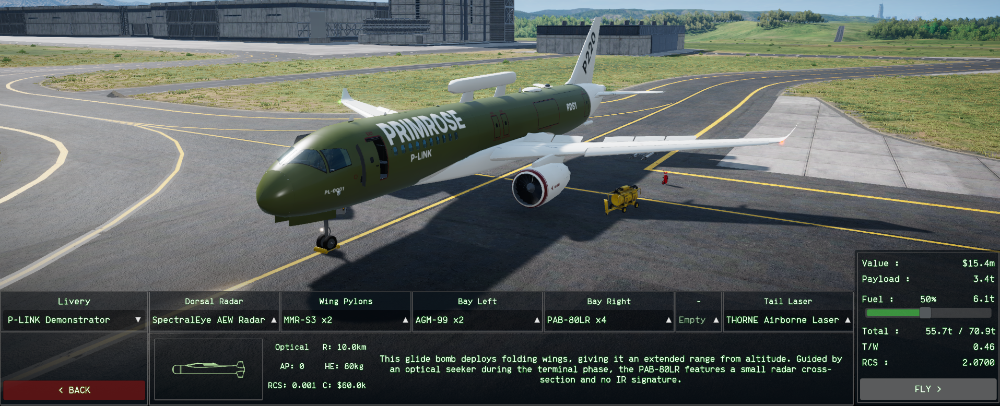
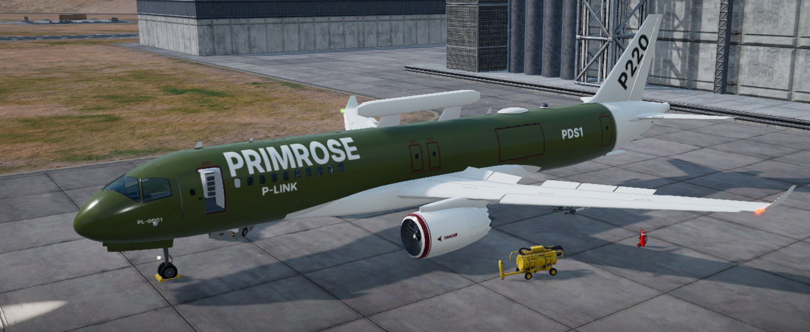
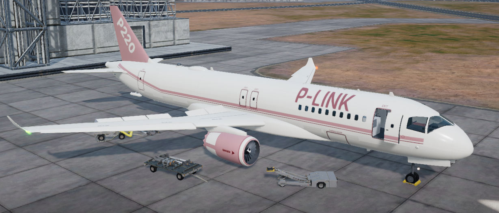
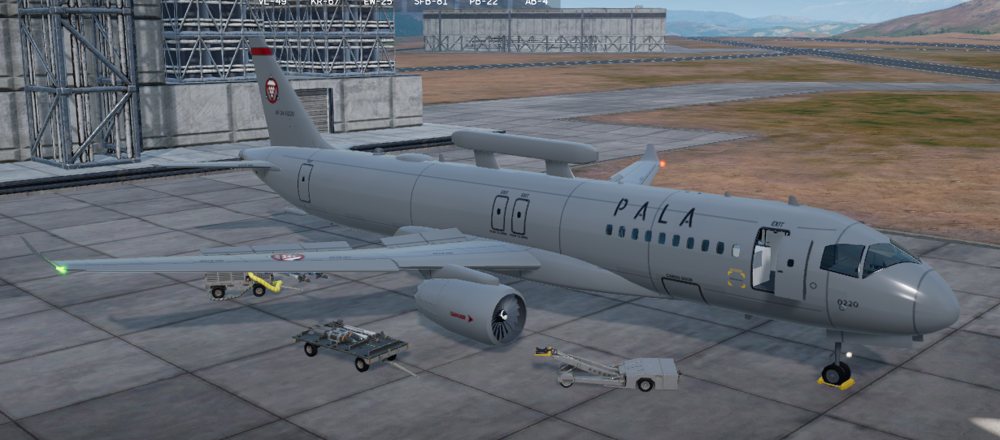
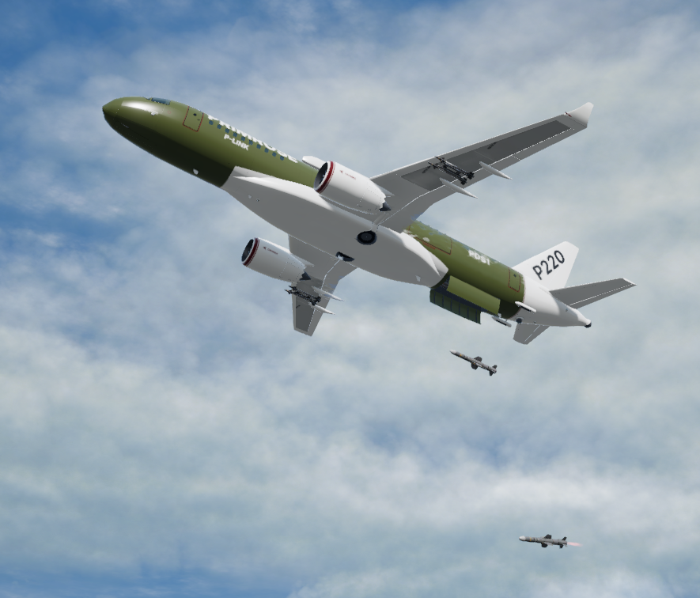

# P220 Primrose

A twin-engine airliner of the airline Primeva Link (P-LINK), converted for military service, for Nuclear Option. It carries a dorsal AEW radar, a rear weapons bay, wing pylons and a defensive laser in the tail.

## Requirements

- Nuclear Option 0.34.2
- [BepInEx 5](https://github.com/BepInEx/BepInEx/releases) (Mono, x64)
- [Blueprinter](https://github.com/nikkorap/NOBlueprinter-Releases) 2.0.1 or newer

## Install

Download `P220Primrose.dll` from the [releases page](../../releases) and put it in `Nuclear Option\BepInEx\plugins`. The mod is one file.

## The aircraft

- SpectralEye AEW Radar, rear weapons bay (Bay Left and Bay Right), wing pylons and a Capacitor Pack option.
- THORNE Airborne Laser in the tail cone.
- Four crew who bail out through the forward doors.
- Three liveries: P-LINK Demonstrator, Primeva Link Service and PALA Air Force Grey (PALA only). Workshop livery tag: `P220 Primrose`.

Claude helped with this project.
