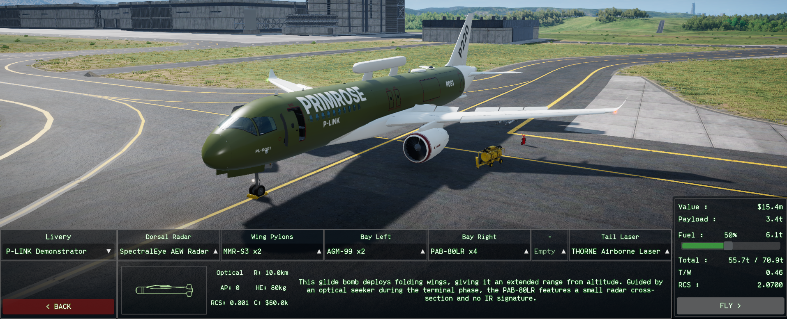
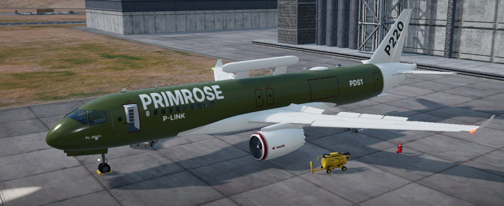
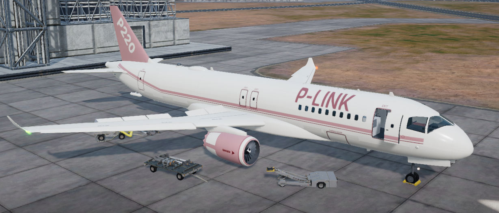
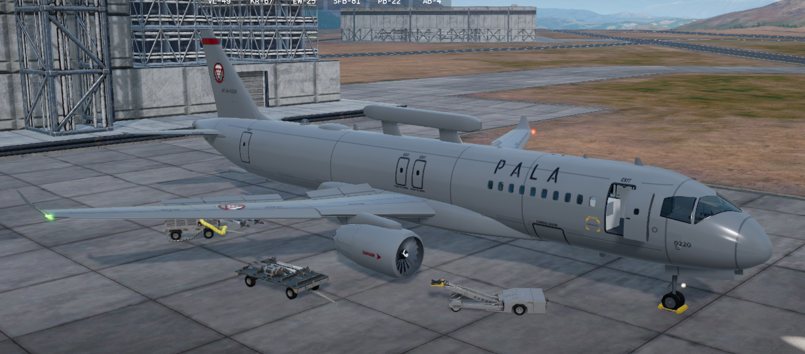
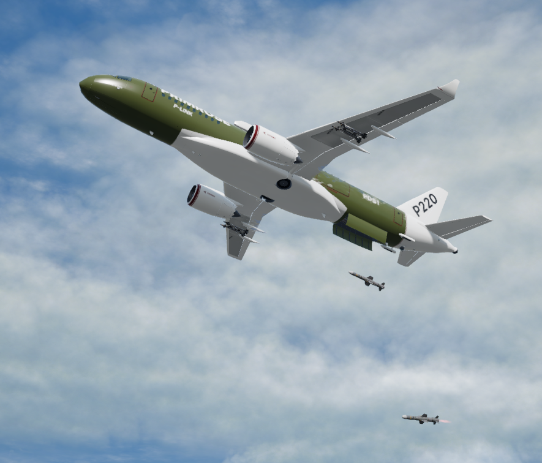

First full release of the P220 Primrose: a Primeva Link airliner converted for military service.

**Install:** drop `P220Primrose.dll` into `Nuclear Option\BepInEx\plugins` (needs BepInEx 5 and Blueprinter). Remove any older P220 DLL first.

**New in 1.0.0:** two new liveries (Primeva Link Service, and PALA Air Force Grey for PALA only), Workshop livery tag `P220 Primrose`, liveries on every outer panel, rounded nose radome, laser arc kept clear of the airframe, rank 2, value 95.

Full list in [CHANGELOG.txt](https://github.com/NicksSoftwareFun/Nuclear-Option-P220-Primrose-Aircraft-Mod/blob/main/CHANGELOG.txt).
