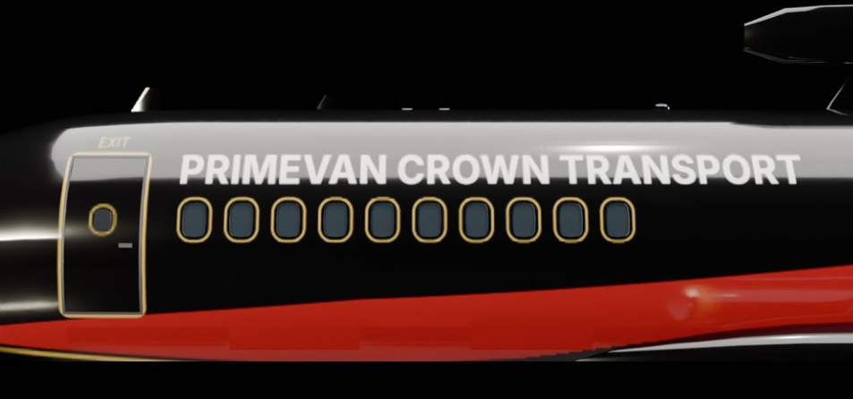

Bonus livery and fixes for the P220 Primrose.

**Install:** drop `P220Primrose.dll` into `Nuclear Option\BepInEx\plugins` (needs BepInEx 5 and Blueprinter), replacing the 1.0.0 DLL.

**New in 1.0.1:**
- Bonus livery Primevan Royal Family (PALA only): gloss black, red swoosh edged in gold, gold engine rings and window borders, PRIMEVAN CROWN TRANSPORT above the windows, white and gold PALA emblem on the tail and nose.
- Wheel hubs take their colour from the livery (gold on the royal livery).
- Main gear leg doors now take the livery.
- Lower fuel burn, close to a real airliner at cruise.
- Helicopter-style flight assists off like the stock jets; thrust reversers stay open on the landing roll.
- PALA lettering in the same typeface as the other liveries.
- Cockpit manual page no longer clips into the panel.
- Livery Bundle updated with all four liveries.

Full list in [CHANGELOG.txt](https://github.com/NicksSoftwareFun/Nuclear-Option-P220-Primrose-Aircraft-Mod/blob/main/CHANGELOG.txt).
