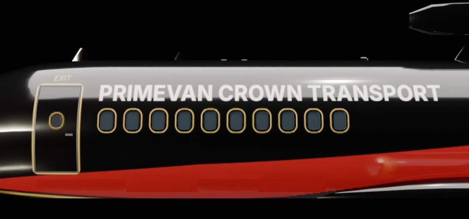

AI landing and handling fixes for the P220 Primrose.

**Install:** drop `P220Primrose.dll` into `Nuclear Option\BepInEx\plugins` (needs BepInEx 5 and Blueprinter), replacing the older DLL.

**New in 1.0.2:**
- AI landings: no more stalling short of the runway or bouncing into a go-around. The AI flies a faster approach, stays down once the wheels touch and holds the nose down on the roll.
- Thrust reversers only open with weight on the main wheels, so the AI no longer opens them on final.
- A P220 that finishes its landing run leaves the runway's landing list, so other aircraft behind it on final no longer go around for traffic.
- AI takeoffs keep the nose down until about 250 km/h (no more tail strikes).
- Centre of gravity moved forward, so the aircraft no longer tips back on full thrust from a standstill.

Full list in [CHANGELOG.txt](https://github.com/NicksSoftwareFun/Nuclear-Option-P220-Primrose-Aircraft-Mod/blob/main/CHANGELOG.txt).
